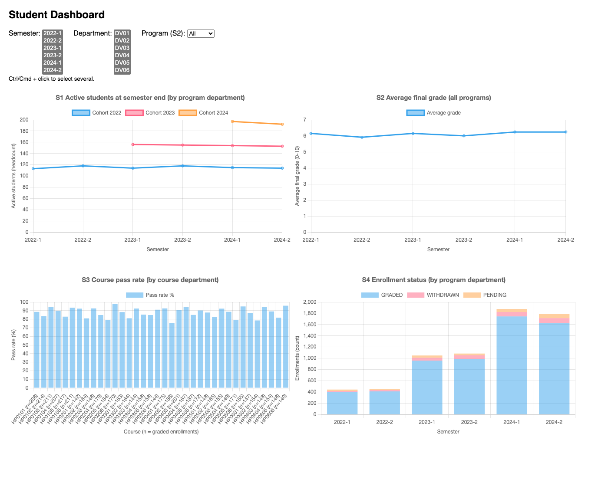
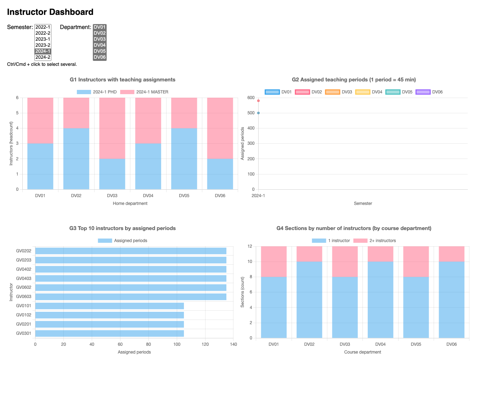

# HUST Data Warehouse — Report

Database: SQLite. Pipeline: `etl/run_pipeline.py`. It loads the CSV files into staging tables (`stg_*`), rebuilds the star schema (`sql/1_schema.sql`, `sql/2_load.sql`), runs the checks (`sql/4_checks.sql`) and generates the two dashboards from `sql/3_charts.sql`.

## 1. Star schemas

```
Student star                                   Instructor star

dim_student ─┐                                 dim_instructor ─┐
dim_program ─┤                                 dim_course ─────┤
dim_term ────┼── fact_student_term             dim_term ───────┼── fact_teaching_assignment
dim_department (program dept) ─┘               dim_department (home dept) ───┤
                                               dim_department (course dept) ─┘
dim_student ─┐
dim_course ──┤
dim_program ─┤
dim_term ────┼── fact_enrollment
dim_department (program dept) ─┤
dim_department (course dept) ──┘
```

| Fact table | Grain (one row =) | Measures | How to aggregate |
|---|---|---|---|
| fact_student_term | one student's status at the end of one semester | count of rows where status = ACTIVE | Count across students and departments, separately for each semester (a headcount cannot be added across semesters). |
| fact_enrollment | one student in one section | count of enrollments, final_score | Counts add up. Average grade = sum(score) / number of GRADED enrollments. Pass rate = passed / graded, recalculated after every grouping. |
| fact_teaching_assignment | one instructor in one section | assigned_periods | Periods add up. Instructors = COUNT(DISTINCT instructor) per semester. Sections = count after grouping by section. |

**Dimensions and keys.** Each dimension has an integer surrogate key (`*_key`) and a unique business key (`*_id`). The relationships are one-to-many:
- department → programs, courses, instructors
- program → students
- each dimension → its fact rows

`section_id` is kept in the facts as a degenerate dimension.

**Shared dimensions.** Both stars use `dim_term`, `dim_department` and `dim_course`.

**Department roles.** There is only one `dim_department` table. The facts point to it through separate foreign keys:
- `program_department_key`: the department that manages the student's program (S1, S2, S4)
- `home_department_key`: the instructor's home department (G1–G3)
- `course_department_key`: the department that owns the course (S3, G4)

## 2. Source-to-target mapping

| Target | Source | Rule / key lookup |
|---|---|---|
| dim_department | departments | copy |
| dim_term | terms | copy |
| dim_program | programs | department_id → department_key |
| dim_student | students | program_id → program_key |
| dim_course | courses | department_id → department_key |
| dim_instructor | instructors | department_id → department_key |
| fact_student_term | student_terms | student_id → student_key, term_id → term_key; program_department_key looked up via the student's program |
| fact_enrollment | enrollments + sections | student_key; term_key and course_key come from the section; program and program department come from the student; course department comes from the course; an empty final_score becomes NULL |
| fact_teaching_assignment | teaching_assignments + sections | instructor_key; term_key and course_key come from the section; home department comes from the instructor; course department comes from the course |

- **Retakes.** The enrollment grain is (student, section) and section IDs are unique across semesters. Each retake is therefore its own row in the semester of that attempt; 621 student–course pairs have more than one attempt.
- **Co-taught sections.** Periods are summed per assignment, so the lead and co-instructor shares add up to the planned periods. G4 first groups assignments by section, so a co-taught section is counted once, in the "2+ instructors" group.

## 3. Test results

Full output: `output/checks.md`. All 23 checks pass.

| Check | Result |
|---|---|
| Row counts source = target for all 10 tables (6, 12, 6, 480, 36, 36, 1760, 6690, 540) | PASS |
| No duplicate keys at the grain of each fact; no foreign key violations | PASS |
| Only GRADED enrollments have a score (missing-grade rule) | PASS |
| Sum of assigned periods = planned periods for every section | PASS |
| Co-taught section L2024-1-012: LEAD 30 + CO 15 = 45 periods; counted once in G4 | PASS |
| ACTIVE student SV20220119 has no enrollments in 2024-1 and is counted in S1 | PASS |
| Rerunning the pipeline on the same input gives identical results | PASS |

**Reconciliation, semester 2024-1, all departments.** There are no discrepancies.

| Metric | Expected | Warehouse |
|---|---|---|
| Active students | 466 | 466 |
| Graded / passed enrollments | 1,743 / 1,543 | 1,743 / 1,543 |
| Instructors with assignments | 36 | 36 |
| Assigned periods / sections | 3,240 / 72 | 3,240 / 72 |

## 4. Dashboards

Files: `dashboards/student_dashboard.html` and `dashboards/instructor_dashboard.html`. Open them in a browser; Chart.js loads from the internet. Both have semester and department filters, and the student dashboard also has a program filter for S2. When several semesters are selected, headcounts stay separate per semester: S1 has semesters on the x-axis, and G1 shows one stack per semester.

**Student dashboard (all semesters)**


**Instructor dashboard (2024-1)**


## 5. Observations

**Student dashboard**
- Active students grew from 113 (2022-1) to 466 (2024-1) because each year brought a new cohort (156 students in 2023, 197 in 2024). Cohort 2022 stayed at about 113–118.
- The pass rate in 2024-1 was 88.5 % (1,543 / 1,743). The lowest course was HP0304 at 79.1 % (34/43) and the highest was HP0606 at 100 % (41/41). The average grade stayed between 5.91 and 6.24.

**Instructor dashboard**
- All 36 instructors (18 PhD, 18 Master) taught in every semester, while active students quadrupled. Students per instructor rose from about 3 to about 13.
- In 2024-1, 18 of the 72 sections (25 %) were co-taught. Six instructors (GV0202, GV0203, GV0402, GV0403, GV0602, GV0603) had the highest load at 135 periods each.
