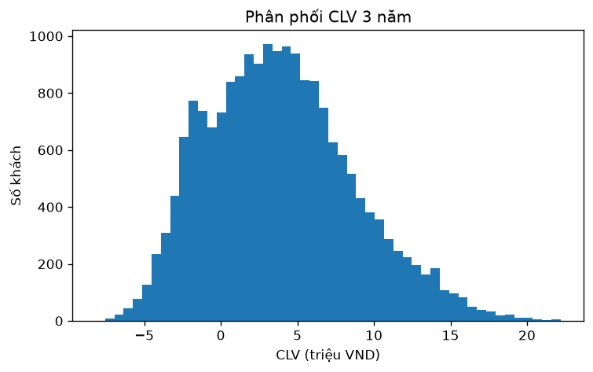
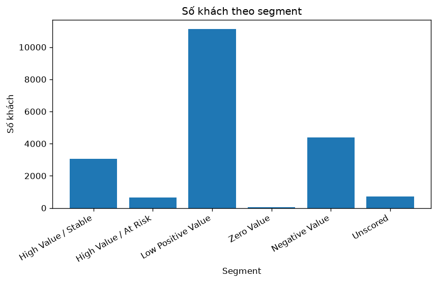
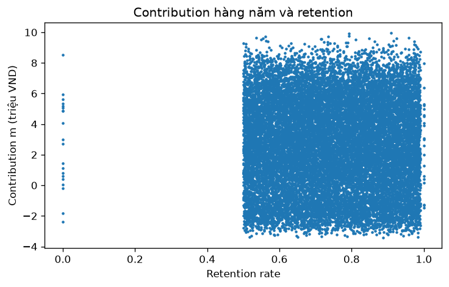

# Báo cáo CLV khách hàng ngân hàng

Dữ liệu giả lập (synthetic). Mốc tính: 1/10/2026. Đơn vị tiền: VND.

## 1. Mục tiêu

Ước tính giá trị 3 năm tới của 20.000 khách hàng hiện tại và chọn tối đa 100 khách để gửi ưu đãi giữ chân với ngân sách 10 triệu VND (100.000 VND mỗi khách).

## 2. Làm sạch dữ liệu

| Bước | Số lượng |
|---|---|
| Dòng economics thô | 20.400 |
| Bỏ dòng trùng hoàn toàn | 300 |
| Bỏ dòng ID không có trong roster (C9xxxx) | 100 |
| Dòng economics sạch | 20.000 |
| Khách trong roster (giữ đủ) | 20.000 |
| Tính được CLV | 19.300 |
| CLV trống (Unscored) | 700 |

700 khách có CLV trống, chia theo lý do:

| quality_status | Số khách | Lý do |
|---|---|---|
| missing_input | 300 | Thiếu fee (100), ECL (100) hoặc retention (100) |
| invalid_input | 300 | servicing_cost âm (100), retention < 0 (100), retention > 1 (100) |
| partial_period | 100 | Kỳ chỉ đến 2026-08-31, chưa đủ 12 tháng |

Cách xử lý: không điền giá trị thiếu và không tự sửa giá trị sai vì không biết giá trị đúng. Những khách này vẫn nằm trong file kết quả với CLV trống. Giá trị 0 thật và contribution âm được giữ nguyên.

## 3. Cách tính CLV

- m = fee + net_interest − servicing_cost − expected_credit_loss
- CLV = m·r/1,1 + m·r²/1,1² + m·r³/1,1³ (d = 10%, contribution nhận cuối mỗi năm, khách rời đi là rời vĩnh viễn)
- Đã kiểm tay 2 khách (C00001 và C00005), kết quả khớp với code.
- Tổng CLV của 19.300 khách là khoảng **75,2 tỷ VND**. Trung vị là 3,6 triệu VND. 4.386 khách (khoảng 23%) có CLV âm.

## 4. Xếp hạng và phân khúc

Xếp hạng theo CLV giảm dần. Nếu bằng nhau thì customer_id nhỏ hơn đứng trước.

Ngưỡng: "High Value" là CLV ≥ 7,96 triệu VND (P75 của các CLV dương). "Stable" là retention ≥ 0,75.

| Segment | Số khách | Tổng CLV (tỷ VND) | CLV trung vị (triệu VND) | Gợi ý quản lý |
|---|---|---|---|---|
| High Value / Stable | 3.068 | 35,57 | 11,09 | Chăm sóc, bán thêm sản phẩm |
| High Value / At Risk | 646 | 5,97 | 8,97 | Liên hệ sớm để giữ chân |
| Low Positive Value | 11.140 | 42,80 | 3,81 | Phục vụ qua kênh số, chi phí thấp |
| Zero Value | 60 | 0 | 0 | Theo dõi |
| Negative Value | 4.386 | −9,13 | −1,87 | Xem lại chi phí và rủi ro tín dụng |
| Unscored | 700 | không có | không có | Sửa dữ liệu trước |

## 5. Chiến dịch giữ chân

Giả định: r' = min(1, r + 0,03). Giá trị tăng thêm = CLV(r') − CLV(r) − 100.000. Chọn tối đa 100 khách có giá trị tăng thêm dương lớn nhất (hòa thì ID nhỏ hơn trước).

- Chọn **100 khách**, chi phí **10.000.000 VND**, tổng lãi ròng **khoảng 102,0 triệu VND**.
- Cả 100 khách thuộc nhóm High Value / Stable, retention trung bình 0,926.
- Danh sách top 10 và đầy đủ 100 khách nằm trong `output/campaign_selected.csv`.

Chỉ 66 trong 100 khách có CLV cao nhất được chọn. Lý do: khách có retention gần 1 chỉ tăng được rất ít khi cộng thêm 3 điểm (r' bị chặn ở 1). Khách có m lớn và retention khoảng 0,90 - 0,96 có giá trị tăng thêm lớn nhất.

**KPI đề xuất**: tỷ lệ khách còn hoạt động sau 12 tháng của nhóm nhận ưu đãi so với nhóm đối chứng, mục tiêu cao hơn ít nhất 3 điểm %.

## 6. Độ nhạy (9 kịch bản)

| d | Dịch r | Tổng CLV (tỷ) | Lãi ròng chiến dịch (triệu) | Top 10 giống gốc | Chọn giống gốc / đổi |
|---|---|---|---|---|---|
| 5% | −5 | 72,54 | 110,4 | 9 | 70 / 30 |
| 5% | 0 | 81,74 | 114,4 | 10 | 100 / 0 |
| 5% | +5 | 91,19 | 115,3 | 8 | 42 / 58 |
| 10% | −5 | 66,87 | 98,5 | 10 | 70 / 30 |
| **10%** | **0 (gốc)** | **75,21** | **102,0** | **10** | **100 / 0** |
| 10% | +5 | 83,76 | 102,8 | 8 | 42 / 58 |
| 15% | −5 | 61,94 | 88,4 | 10 | 71 / 29 |
| 15% | 0 | 69,54 | 91,4 | 10 | 100 / 0 |
| 15% | +5 | 77,33 | 92,2 | 8 | 42 / 58 |

- Danh sách top 10 CLV khá ổn định (giống gốc 8 - 10 khách).
- Danh sách chọn chiến dịch ổn định khi chỉ đổi d, nhưng đổi nhiều (29 - 58 khách) khi retention thay đổi 5 điểm. Vì vậy nên kiểm chứng retention trước khi chọn danh sách cuối.

## 7. Hạn chế

1. Contribution không đổi và khách rời đi vĩnh viễn là giả định đơn giản.
2. Chỉ tính 3 năm, không có giá trị cuối kỳ, nên CLV của khách ổn định bị thấp hơn thực tế.
3. Uplift 3 điểm chỉ là giả định, chưa được chứng minh.
4. Retention là giá trị cho sẵn, nếu sai thì kết quả sai theo.
5. Contribution chưa tính thuế, chi phí vốn và chi phí chung.

**Thử nghiệm ngẫu nhiên**: chia ngẫu nhiên khách đủ điều kiện thành nhóm nhận ưu đãi và nhóm đối chứng, theo dõi 12 tháng, chênh lệch retention giữa hai nhóm là uplift thật.

## 8. CLV và RFM, khách giá trị âm

- RFM mô tả hành vi trong quá khứ, CLV ước tính giá trị tương lai sau khi trừ chi phí và rủi ro. Nên dùng cả hai.
- Với khách giá trị âm: chuyển sang kênh số, tự phục vụ, xem lại gói phí và hạn mức tín dụng. Không dùng CLV một mình để từ chối hoặc hạn chế dịch vụ vì thiếu công bằng. Tuổi, thành phố, kênh onboarding chỉ dùng để mô tả.
