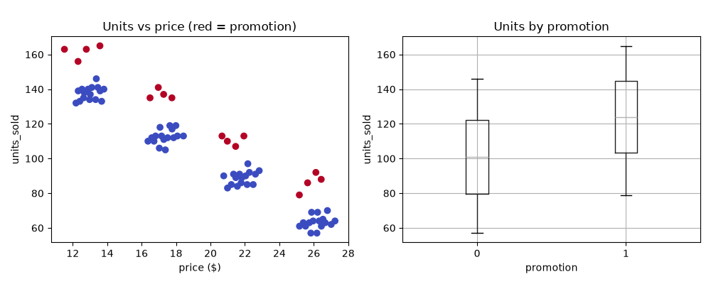
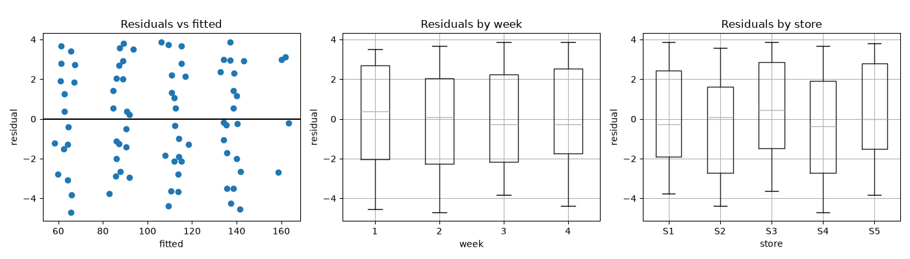

# Retail Price and Demand Lab

Code: `lab.py`. Full output: `output.txt`. Plots: `plot1_inspect.png`, `plot2_residuals.png`.

## Task 1: Inspect
- The data has 80 rows: 5 stores × 4 products × 4 weeks. There are no missing values and no duplicate (week, store, product) rows.
- Units sold fall as price rises, but price mostly reflects product tier: P1 costs about $12 and P4 about $26.
- Promotion weeks average 123.9 units, compared with 100.6 units in non-promotion weeks.
- Mean units drift slightly down by week (107.4 → 103.2) and slightly up by store (S1 102.0 → S5 109.8).

## Task 2: Models
Both models are fit on weeks 1–3 (60 rows) and tested on week 4 (20 rows). Holding out the last week mimics deployment, where the model predicts an unseen future week.

| | Model A: price only | Model B: + promotion, ad_spend, competitor_price |
|---|---|---|
| price coef (95% CI) | −5.6 (−6.1, −5.1) | −14.4 (−17.4, −11.4) |
| promotion | – | +8.3 (5.3, 11.3) |
| ad_spend (per $) | – | +0.30 (0.25, 0.35) |
| competitor_price | – | +8.2 (5.2, 11.1) |
| R² train | 0.893 | 0.993 |
| RMSE week 4 | 11.50 | 2.95 |

## Task 3: Model behavior (Model B, all 80 rows)
- **Residuals vs fitted:** no clear pattern is visible.
- **Residuals by week and by store:** centred on zero, with no strong drift.
- **Influential points:** the highest Cook's distances are 0.065, 0.060 and 0.048, all in promotion weeks. Only two are just above 4/n = 0.05, and none is extreme.
- **Group-aware validation:** mean RMSE when leaving one store out is A = 10.73 and B = 2.61. When leaving one product out it is A = 10.12 and B = 2.58.
- **What the sample cannot establish:**
  - The data covers only 4 weeks of synthetic data.
  - Price and competitor price move together closely, and promotions come with higher ad spend, so their separate effects are hard to tell apart.
  - The data is observational: prices were not randomly assigned, so it cannot show the causal effect of a price change.

## Decision memo
1. The question was whether raising price by $1 reduces weekly units sold, where one unit of analysis is one product in one store in one week (80 observations).
2. Price alone is associated with −5.6 units per $1 (95% CI −6.1 to −5.1). After holding promotion, ad spend and competitor price constant, the estimate is −14.4 units per $1 (95% CI −17.4 to −11.4).
3. Adding the controls made the price coefficient much larger in magnitude and cut the week-4 RMSE from 11.5 to 3.0 units. Leave-one-store-out and leave-one-product-out validation gave similar results (about 2.6 vs 10–11).
4. The evidence supports a negative price association, but not a precise causal effect, so I recommend a controlled price test before changing prices. For example, raise price by $1 in randomly chosen stores while keeping promotions and ads unchanged, and run it for more weeks.

## Discussion
- **Did the price coefficient change after adjustment?** Yes, from −5.6 to −14.4. Competitor price rises together with our price and is positively related to demand. Leaving it out of Model A hides part of the price effect.
- **Does promotion have a conditional association?** Yes: about +8 units, holding price, ad spend and competitor price fixed. That is much smaller than the raw gap of +23 units, because promotion weeks also have lower prices and higher ad spend.
- **Would you use the model to set prices tomorrow?** No. The data is short and observational, price and competitor price are collinear, and there was no random price variation.
- **What would strengthen a price claim?** A randomized or A/B price test across stores, more weeks of data, cost and margin data, and promotions and ad spend that are planned separately from price.
